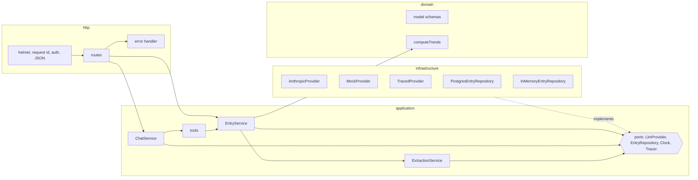

# EntrySense


A typed Express API that turns free-text health notes into validated records using LLM structured output, and answers questions about them through a bounded tool-calling loop. An eval suite with a committed baseline measures extraction accuracy, so a prompt change that makes extraction worse fails CI.

```text
POST /entries  "Yesterday I slept 6 hours, energy 8/10, sore throat and a cough."
          ->   { "date": "2026-09-27", "sleepHours": 6, "energy": 4, "symptoms": ["cough", "sore_throat"], ... }
```

Node 22 · TypeScript (strict) · Express 5 · Zod 4 · Drizzle + PostgreSQL · Anthropic SDK · Langfuse · pino · Vitest

## Why I built this

For about a year my job was the frontend of ai+me, a platform for testing LLM apps. I saw a lot of model output up close, and the thing that stuck with me is how often it was almost right. A field missing, a number out of range, a symptom spelled a way nobody expected.

So I wanted to build the other side of it myself: a small typed API where the model is treated like untrusted input, not like a trusted service. That's what EntrySense is. A note comes in, the model turns it into a record, the record goes through the same Zod schema a user's input would. If it fails, the model gets one chance to fix it, and after that the request is a 422.

I used an AI coding assistant while building it, like most people do now. The structure, the validate-and-retry idea, the step budget and the tracing are my decisions, and I went through every file. If you open any of them, I can tell you why it looks the way it does.

## Quick start

No API key needed. The sample configuration uses an offline provider ([why](docs/adr/0004-offline-mock-provider.md)) and in-memory storage.

```bash
npm install
cp .env.example .env
npm run dev
```

With PostgreSQL:

```bash
docker compose up -d
# in .env: STORAGE=postgres
npm run db:migrate
npm run dev
```

With a real model, set `LLM_PROVIDER=anthropic` and `ANTHROPIC_API_KEY` in `.env`.

For a production build, run `npm run build`, then `npm run db:migrate:dist` and `npm start`. With `NODE_ENV=production` the app refuses to start with in-memory storage or the sample API key.

Sample requests are in [`api.http`](api.http). Here is a `/chat` exchange with the offline provider:

```json
{
  "answer": "I found 2 matching entries (2026-09-28, 2026-09-24). Between 2026-09-23 and 2026-09-29 you logged 3 days, averaged 7.17 hours of sleep, had an average energy of 4/5. The most frequent symptom was sore throat (2x). Your longest logging streak was 2 days.",
  "toolCalls": [
    {
      "name": "search_entries",
      "input": { "from": "2026-09-23", "to": "2026-09-29", "symptom": "sore_throat" },
      "ok": true
    },
    { "name": "get_trends", "input": { "from": "2026-09-23", "to": "2026-09-29" }, "ok": true }
  ],
  "steps": 2
}
```

## API

Every route except `/health` and `/ready` requires an `X-API-Key` header.

| Method | Path                                     | Description                                                                                                          |
| ------ | ---------------------------------------- | -------------------------------------------------------------------------------------------------------------------- |
| `POST` | `/entries`                               | `{ text }`. Extracts `{ date?, sleepHours?, energy 1..5?, mood?, symptoms[] }`, validates it, stores it.             |
| `GET`  | `/entries?from&to&symptom&page&pageSize` | Entries, newest first.                                                                                               |
| `GET`  | `/trends?from&to`                        | Averages, mood distribution, top symptoms, streaks. No LLM involved. Ranges up to 366 days.                          |
| `POST` | `/chat`                                  | `{ question }`. Tool-calling loop (max 5 steps) over `search_entries` and `get_trends`. Returns the tools it called. |
| `GET`  | `/health`, `/ready`                      | Liveness, and readiness (storage reachable, not shutting down).                                                      |

Errors share one shape, and every response carries an `X-Request-Id`:

```json
{ "error": { "code": "EXTRACTION_FAILED", "message": "...", "details": {}, "requestId": "..." } }
```

| Code                                      | Status | Meaning                                               |
| ----------------------------------------- | ------ | ----------------------------------------------------- |
| `VALIDATION_ERROR`                        | 400    | Invalid body or query, including malformed JSON       |
| `UNAUTHORIZED`                            | 401    | Missing or wrong API key                              |
| `NOT_FOUND`                               | 404    | Unknown route                                         |
| `PAYLOAD_TOO_LARGE`                       | 413    | Body over 16 kB                                       |
| `EXTRACTION_FAILED`                       | 422    | Model output still invalid after one corrective retry |
| `TOOL_LOOP_LIMIT`, `LLM_INVALID_RESPONSE` | 502    | The model did not finish, or its output was truncated |
| `LLM_UNAVAILABLE`, `SERVICE_UNAVAILABLE`  | 503    | Transient upstream failure, or instance not ready     |
| `INTERNAL_ERROR`                          | 500    | Anything unexpected. Details are logged, not returned |

## Architecture



```text
src/
  domain/           schemas and pure calculations, no dependencies beyond Zod
  application/      use cases (entries, extraction, chat), their ports and errors
  infrastructure/   adapters: Anthropic, offline mock, tracing, Postgres, in-memory, clock, config
  http/             Express app, routes, contracts, middleware, error mapping
  container.ts      composition root, the only place that chooses implementations
  server.ts         process entry point and graceful shutdown
```

Dependencies point inwards (`domain <- application <- infrastructure, http <- container`). ESLint enforces the rule, so an import from `application` into `infrastructure` fails lint.

How it works:

- **Extraction.** The model is forced to make a single `record_entry` tool call, whose JSON Schema is generated from the same Zod schema that validates the result. If validation fails, the issues go back to the model once. A second failure is a `422`, and nothing is stored. The database has matching CHECK constraints.
- **Chat.** The model plans tool calls. Tool arguments are validated before execution, and invalid ones are returned to the model as errors. The loop stops after five steps, and a truncated answer is an error rather than a partial `200`.
- **Cancellation.** Model calls are aborted when the client disconnects, and every request has a 60-second deadline across all of its model calls.
- **Tracing.** Every request is an OpenTelemetry span, and every model call is a child span with the GenAI conventions (provider, model, tokens) plus its estimated cost. Log lines carry `trace_id` and `span_id`. Note content never goes on a span, because it is health data. Langfuse can run alongside for prompt debugging, with content only when `TRACE_CONTENT=true`.
- **Dates.** "Today" and "yesterday" are resolved in `TIME_ZONE`, not UTC.

Decision records are in [`docs/adr`](docs/adr/README.md).

## Observability

Traces go to any OTLP/HTTP backend, and pointing them somewhere else takes no code changes.

```bash
# Local: Jaeger UI on http://localhost:16686
docker compose --profile observability up -d
# in .env: OTEL_EXPORTER_OTLP_ENDPOINT=http://localhost:4318
```

To send them to Dynatrace instead, set `OTEL_EXPORTER_OTLP_ENDPOINT=https://<environment-id>.live.dynatrace.com/api/v2/otlp` and `OTEL_EXPORTER_OTLP_HEADERS=Authorization=Api-Token <token>`. The token needs the `openTelemetryTrace.ingest` scope ([Dynatrace OTLP API](https://docs.dynatrace.com/docs/ingest-from/opentelemetry/otlp-api)). An incoming W3C `traceparent` is continued, so EntrySense joins traces started upstream.

A `POST /entries` whose first extraction fails validation looks like this:

```text
POST /entries                         SERVER  201   http.route=/entries
├─ chat mock-heuristic-v1             CLIENT        gen_ai.usage.input_tokens=…  entrysense.operation=extract-entry
└─ chat mock-heuristic-v1             CLIENT        (the corrective retry)
```

## Quality

```bash
npm run check      # format, lint, typecheck, tests with coverage thresholds
npm run eval       # extraction accuracy for the configured provider
```

- 126 tests: unit tests for the domain, the use cases and each adapter, and HTTP integration tests that run through the real composition root. Response bodies are parsed with their contract schemas. Four Postgres repository tests run against a real database when `TEST_DATABASE_URL` is set, which CI does.
- Coverage thresholds: 90% lines, functions and statements, 80% branches.
- `strict`, `noUncheckedIndexedAccess`, `exactOptionalPropertyTypes`, and `typescript-eslint` strict type-checked rules. No `any`.
- CI runs on pushes to `main` and on pull requests. It covers everything above, plus a check that the migrations match the schema, the eval against its baseline, a check that committed eval results are current, and the build.

## Eval

`npm run eval` runs 15 hand-labelled notes through the real `ExtractionService` and reports field-level accuracy for the configured provider. The run fails if overall accuracy drops below that provider's baseline in [`eval/baseline.json`](eval/baseline.json). A field that is absent from both the output and the label counts as correct, because not inventing a value is part of the task.

The results below are from the **offline rule-based provider**, not a language model. They are the baseline a model has to beat:

| Field                     | Accuracy |
| ------------------------- | -------- |
| date                      | 100%     |
| sleepHours                | 93%      |
| energy                    | 87%      |
| mood                      | 67%      |
| symptoms                  | 73%      |
| **overall (field-level)** | **84%**  |

Symptom precision is 100% and recall 76%. One case needed a corrective retry, and none failed outright. The full per-case table is in [`eval/results-mock.md`](eval/results-mock.md).

The misses are phrasings rules can't cover, such as "mood good", "not great", "barely slept", "scratchy throat" and "body aches".

## Out of scope

No frontend, user accounts, streaming, embeddings or queues. Streaming would be SSE on `/chat`. The first scaling limit is extraction throughput, which would move behind a queue.

## License

[MIT](LICENSE)
